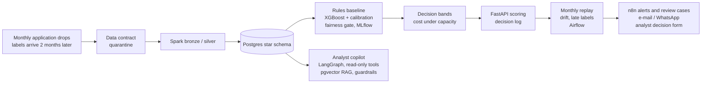

# SIGAP · Sistem Identifikasi Gejala Anomali Pengajuan

SIGAP decides what to do with each online account-opening application at a fictional Indonesian digital bank,
**approve, send to review, or decline**, keeps the fraud team informed when something needs attention, and helps
the analyst who reviews a case.

It is built the way a fraud team would have to defend it: rules are the baseline to beat, thresholds come from the
cost of fraud versus the cost of friction under the review team's capacity, labels arrive two months late, every
model passes a written release gate, and the analyst copilot can read data but never decide.

**Status:** end to end on the BAF Base dataset (1,000,000 applications, 8 months), October 2026. All results come
from an offline replay, not live traffic. Money figures are scenarios built on written assumptions.



## Results

| Stage | Result | Source |
|---|---|---|
| Data | 1,000,000 applications, fraud 1.10%; train months 0–4 (1.00%), validation month 5 (1.18%), test months 6–7 (1.40%); 0% quarantined in every month | [data card](docs/02_DATA_CARD.md), [EDA](docs/03_EDA_FINDINGS.md) |
| Rules baseline | 5 rules from the EDA: month 5 flags 7.86% of applications and catches 45.2% of fraud | [decision policy](docs/04_DECISION_POLICY.md) |
| Model | XGBoost with Platt calibration, no protected attributes as inputs. Test months 6–7: recall 0.521 at FPR 0.053, PR-AUC 0.175, ROC-AUC 0.882, ECE 0.0034. At the rules' alert rate it catches 59% of fraud vs 45% | [model card](docs/MODEL_CARD.md) |
| Fairness | False-positive rate aged 50+ vs under 50: ratio 0.58 on test (release limit 0.50; 0.32 for the model trained on all features), at a cost of 1.9 points of validation recall | [model card](docs/MODEL_CARD.md), [ADR 0005](docs/adr/0005-fairness-age-predictive-equality.md) |
| Decision policy | Model + bands vs rules on months 6–7: stops 44.6% vs 31.9% of fraud while reviewing 6.05% vs 8.23% of applications; automatic declines capped at 1% (62 genuine applicants per 10,000; 413 without the cap). Scenario saving Rp 216.5 million per 10,000 applications (Rp 43–431 million across the sensitivity range) | [decision policy](docs/04_DECISION_POLICY.md), [business memo](docs/05_BUSINESS_MEMO.md) |
| Serving | FastAPI in Docker: round-trip p95 12.3 ms over 500 requests on a MacBook Air (target < 100 ms) | [runbook](docs/RUNBOOK.md) |
| Monitoring | Replay of months 5–7: `credit_risk_score` drifted past PSI 0.25 in months 6–7 while the score's PSI stayed at 0.03–0.08; recall when labels arrived 0.518 / 0.509 / 0.532; the age FPR ratio fell 0.65 → 0.60 → 0.56, still above the limit | [monitoring replay](docs/06_MONITORING_REPLAY.md) |
| Fraud-ops automation | 12 alerts and the daily review summary delivered by n8n, one analyst decision written back through the validated API. WhatsApp from the Meta test number was accepted by the API but failed delivery (error 130497, cross-border restriction for Indonesian users), so alerts now go through a channel switch with e-mail as default | [ADR 0007](docs/adr/0007-ops-automation-n8n-whatsapp.md) |
| Copilot | 24-case golden set: prompt v2 passed 24/24 vs 17/24 for v1 (McNemar p = 0.016), p50 4.0 s, USD 0.017 per run. The evaluation also caught a bug in the copilot's own grounding guard, fixed with a regression test | [ADR 0004](docs/adr/0004-copilot-prompt-and-eval.md), [ADR 0003](docs/adr/0003-copilot-read-only-tools.md) |
| Model choice | Same set and prompt: Claude Haiku 5.5 24/24, local Hermes 3 8B 12/24 (p ≈ 0.0005), p95 latency 6.7 s vs 31.2 s. The guardrails held with the weaker model: it never approved anything or kept an invented number | [ADR 0008](docs/adr/0008-local-vs-api-llm.md), [compare.md](reports/copilot_eval/compare.md) |

## What is not proven yet

- Everything above is an offline replay on one BAF variant (Base). A live challenger test on a share of traffic is
  the recommended next step ([memo](docs/05_BUSINESS_MEMO.md)).
- Costs per fraud, review and decline are assumptions with public reference points, not bank figures.
- Fairness is audited for age only, and the age FPR ratio is trending down.
- The local model comparison covers one small model (Hermes 3 8B); a stronger open-weight model and a tool-routing
  step for small models are planned and will be reported against a held-out set of new cases.

## Data

[Bank Account Fraud (BAF) suite](https://github.com/feedzai/bank-account-fraud), Jesus et al. (2022),
*Turning the Tables: Biased, Imbalanced, Dynamic Tabular Datasets for ML Evaluation*, NeurIPS Datasets and
Benchmarks, licence CC BY-NC-SA 4.0. Raw rows are not in this repository. Tests and CI use BAF-shaped synthetic data
from `scripts/make_synthetic.py`, which is never used to report results.

## Run

```bash
make setup            # Python 3.12 venv (Java 17 for Spark)
cp .env.example .env  # then: make env-secrets
make doctor P=0       # tools ready? (P=3 Spark, P=8b n8n, P=9 copilot, P=9b Ollama)
make check P=1        # acceptance tests of one phase; make test runs all
make help             # every command, in pipeline order
```

The full pipeline needs the BAF files from Kaggle (`make data-download`); `make synth` creates synthetic data in
the same shape for trying the code without them.

| Layer | Built with |
|---|---|
| Acquisition, quality | Python, Kaggle API, YAML data contract |
| Pipeline, warehouse | PySpark, Postgres 16 star schema, SQL |
| Model, policy | scikit-learn, XGBoost, SHAP, MLflow, NumPy, pandas |
| Serving, monitoring | FastAPI, Pydantic, Docker, Airflow, GitHub Actions |
| Fraud ops | n8n, Gmail SMTP, WhatsApp Cloud API |
| Copilot | LangGraph, MCP, pgvector, sentence-transformers, Claude API, Ollama |

## Documents

[PRD](docs/00_PRD.md) · [ERD](docs/01_ERD.md) · [data card](docs/02_DATA_CARD.md) ·
[EDA findings](docs/03_EDA_FINDINGS.md) · [decision policy](docs/04_DECISION_POLICY.md) ·
[business memo](docs/05_BUSINESS_MEMO.md) · [monitoring replay](docs/06_MONITORING_REPLAY.md) ·
[model card](docs/MODEL_CARD.md) · [runbook](docs/RUNBOOK.md) · [architecture decisions](docs/adr/) ·
[job-description map](docs/JD_MAP.md)
