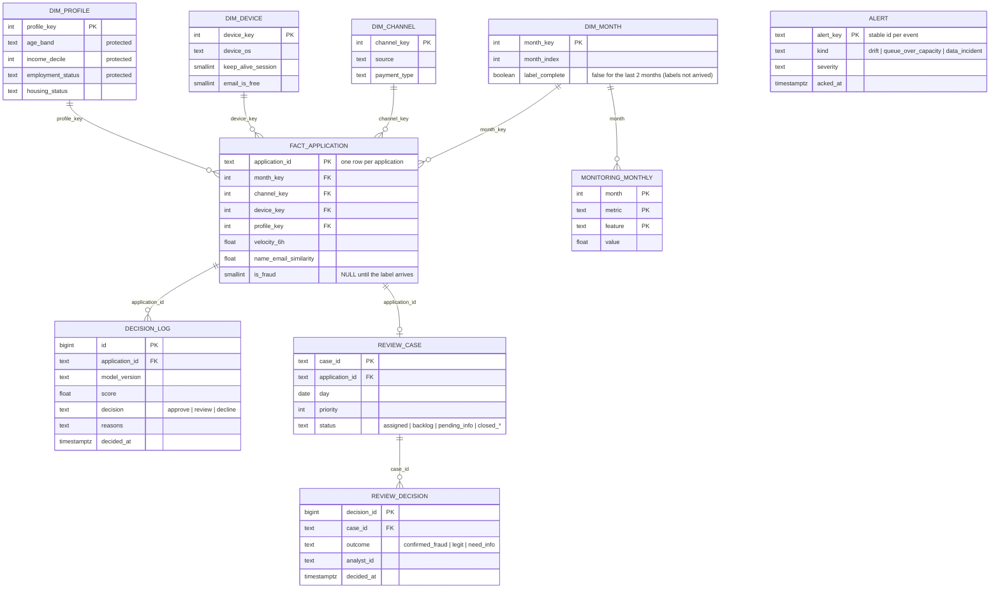

# ERD · warehouse and operational tables

Draft (phase 0). The final version follows the DDL in `sql/warehouse/`.

**Grain of the fact table:** one row per account-opening application.

## Design decisions
- **Star schema, not one wide table.** Analysts, the dashboard and the copilot ask the same questions by month,
  channel, device and profile. Dimensions keep those queries short, and protected attributes live in one
  dimension (`dim_profile`) that the copilot's read-only role cannot see.
- **Labels in the fact table, completeness in `dim_month`.** `is_fraud` stays NULL until the label feed delivers
  it; `label_complete` marks months whose labels have all arrived, so a dashboard never reports a fraud rate for
  a month that only looks clean because its labels are missing.
- **Operational schema `ops`.** Decisions, monitoring, alerts and review cases are written by the running
  system, not by the batch pipeline, and are kept apart from the analytical `gold` schema.
- **Analyst decisions are not labels.** `review_decision` records what an analyst concluded for a reviewed case;
  it never overwrites `fact_application.is_fraud`.
