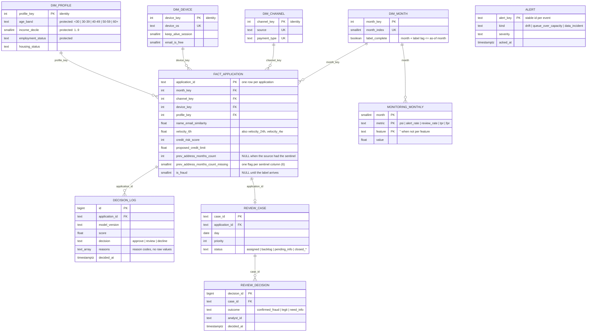

# ERD · warehouse and operational tables

Matches the DDL in `sql/warehouse/001_schemas.sql` (gold + decision/monitoring tables) and `003_ops.sql`
(review cases and alerts). Loaded by `src/sigap/pipeline/gold.py`.

**Grain of the fact table:** one row per account-opening application.

## Design decisions
- **Star schema, not one wide table.** Analysts, the dashboard and the copilot ask the same questions by month,
  channel, device and profile. Dimensions keep those queries short, and protected attributes live in one
  dimension (`dim_profile`) that the copilot's read-only role cannot see.
- **Labels in the fact table, completeness in `dim_month`.** `is_fraud` stays NULL until the label feed delivers
  it; `label_complete` marks months whose labels have all arrived, so a dashboard never reports a fraud rate for
  a month that only looks clean because its labels are missing.
- **Operational schema `ops`.** Decisions, monitoring, alerts and review cases are written by the running
  system, not by the batch pipeline, and are kept apart from the analytical `gold` schema.
- **Analyst decisions are not labels.** `review_decision` records what an analyst concluded for a reviewed case;
  it never overwrites `fact_application.is_fraud`.
- **Decision log without a foreign key.** The API decides before an application reaches the warehouse, so
  `ops.decision_log.application_id` is a logical link to the fact table, not an enforced one.
- **Stable surrogate keys.** Dimension keys are identity columns and new categories are inserted with
  `ON CONFLICT DO NOTHING`, so a key never changes after it is assigned. The fact is upserted on
  `application_id`; the load never truncates, so decisions logged for loaded applications keep their match.
- **Point in time.** The warehouse is built as of the latest month in silver: a label is joined only when
  `available_month <= as_of`. With 8 months and a 2-month lag, months 0–5 are labelled and months 6–7 are not
  yet; re-running after the next drop fills them in.
- **Sentinels as NULL + flag.** The six sentinel columns are NULL in the fact, with a `*_missing` flag beside
  each one (EDA finding F1: the missing pattern itself is a fraud signal).
